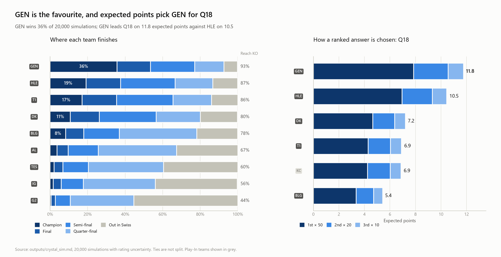
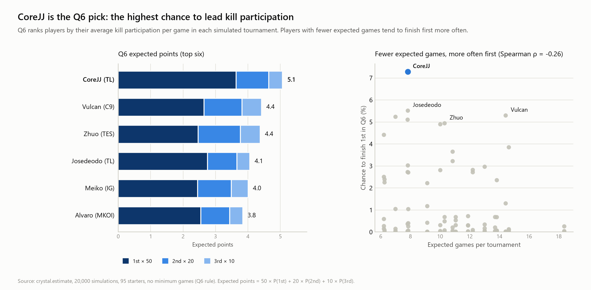
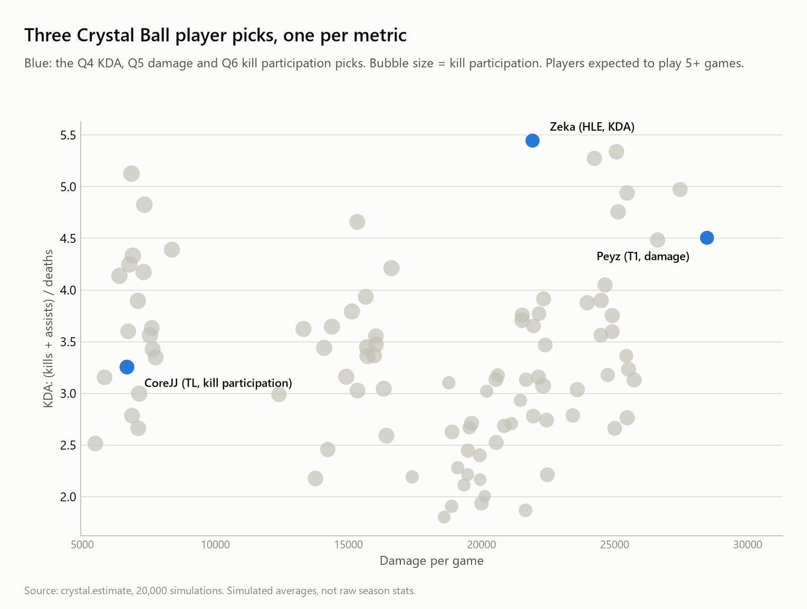
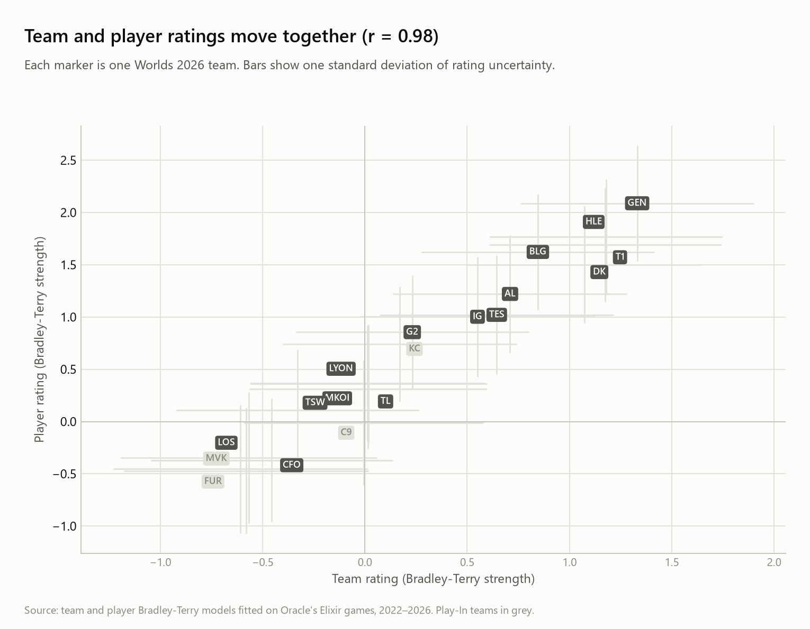

# Worlds 2026 Pick'Em

Our picks for the Worlds 2026 Pick'Em, and the numbers behind them.

We played the tournament 20,000 times on a computer, using past pro results to judge how strong each team and player is. Each pick is the answer that scored the most points across those runs.

**Done:** Play-In and Crystal Ball picks (v4.5, 12 Oct 2026)
**To do:** Main stage picks (Swiss and Knockouts)

Deadlines: freeze 14 Oct, 20:00 · Play-In and Crystal Ball lock about 15 Oct · Swiss before 23 Oct · Knockouts before 3 Nov

## Play-In picks

| Match | Pick | Chance it's right |
|---|---|---|
| FURIA vs MVK | FURIA | 62% |
| C9 vs KC | KC | 68% |
| Upper final | KC | 57% |
| Lower round 1 | C9 | 51% |
| Lower final | C9 | 37% |
| Grand Final | KC | 64% |

Expected score: 19.8 out of 35.

## Crystal Ball picks

Some questions score 50 points for 1st, 20 for 2nd and 10 for 3rd. For those, the table shows the expected points (higher is better). Other questions show the chance the answer is right.

| # | Question | Pick | Value |
|---|---|---|---|
| 1 | Champion picked most often | Cassiopeia | 25.7 pts |
| 2 | Champion with the best win rate (picked 5+ times) | Anivia | 2.7 pts |
| 3 | Champion with the most deaths per game (picked 5+ times) | Rell | 9.2 pts |
| 4 | Best KDA player | Zeka | 9.9 pts |
| 5 | Most damage per game | Peyz | 13.1 pts |
| 6 | Highest kill participation | CoreJJ | 5.2 pts |
| 7 | Peyz or Gumayusi, more kills | Peyz | 66% |
| 8 | Faker reaches 700 kills (needs 84) | No | 96% |
| 9 | Teemo picked | No | ~98% |
| 10 | Unique champions picked | 0–99 | 45% |
| 11 | Games before or after 32 minutes | After | ~65% |
| 12 | Any player gets 15+ kills in a game | Yes | 84% |
| 13 | Any player gets 450+ CS in a game | Yes | ~99% |
| 14 | Finals MVP role | Bot | 39% |
| 15 | Regions in the Knockouts | 3 | 45% |
| 16 | An LCS team reaches the Knockouts | No | 49% (coin flip) |
| 17 | HLE or T1 finishes higher | HLE | 46% vs 43% (close) |
| 18 | Team that wins the shortest game | Gen.G | 11.8 pts |

The full tables and reasons for each answer are in `outputs/picks.md`.

## How we picked

- **Strength:** we rated every team and player from pro games since 2022.
- **Simulations:** 20,000 tournaments, played game by game. Each run uses slightly different strengths, so the results show how sure we are.
- **Scoring questions:** we pick the answer with the most expected points, where 50 points go to 1st, 20 to 2nd and 10 to 3rd.
- **Other questions:** we pick the most likely answer.
- **Champion questions (1–3, 10):** come from a separate set of 5,000 draft simulations.

## Charts

**Where each team finishes.** Left: how far each team goes in 20,000 simulations. Right: how Q18 is decided, using Gen.G and HLE as the example.



**Why CoreJJ for Q6.** He has the best chance of finishing first in kill participation. Players with fewer expected games tend to finish first more often.



**Starters, simulated averages.** Damage and KDA per game for each starter expected to play 5+ games. The three blue dots are our player picks. These are simulated numbers, not raw season stats.



**Team strength.** Each team's team rating against its player rating. Teams near the top right are strong on both.



## For developers

Needs Python with `numpy`, `pandas`, `duckdb`, `scipy` and `matplotlib`.

Put the Oracle's Elixir CSVs in `data/raw/oe/` (download by hand; the S3 links are dead). Then, from the project root:

```
python -m ingest.oracles
python -m ingest.rosters_from_db
python -m ingest.assets
python -m crystal.draft --main
python -m crystal.estimate 20000
python -m crystal.overview_plot
python -m crystal.charts
```

`ingest.assets` downloads team logos and champion icons into `data/raw/` (git-ignored). Team logos are not all available yet, so charts show team codes until they are.

The full rerun order, with timings, is in `ROADMAP.md`.

Files:
- `outputs/picks.md`: answer sheet (edited by hand)
- `outputs/crystal_sim.md`: tables from the 20,000-run simulation
- `outputs/charts/`: the charts above
- `data/raw/`: logos and icons (git-ignored)
- `ROADMAP.md`: plan, data sources, rerun order
- `common/`, `config/`, `data/`, `ingest/`, `model/`, `sim/`, `crystal/`: code
